# Digital Shopping


[](https://github.com/MFCAtash/digital-shopping/actions/workflows/backend-ci.yml)
[](https://github.com/MFCAtash/digital-shopping/actions/workflows/web-ci.yml)
[](https://github.com/MFCAtash/digital-shopping/actions/workflows/ui-ci.yml)
[](https://github.com/MFCAtash/digital-shopping/actions/workflows/security.yml)
[](https://github.com/MFCAtash/digital-shopping/actions/workflows/codeql.yml)
[](https://codecov.io/gh/MFCAtash/digital-shopping)
[](https://scorecard.dev/viewer/?uri=github.com/MFCAtash/digital-shopping)
[](LICENSE)

**Language / زبان:** [English](#english) · [فارسی](#فارسی)

---

<a id="english"></a>

## English

**A digital storefront where every price has a history, every claim has evidence, and every interface speaks the user's language — Persian and English, eight themes, one uncompromising standard of trust.**

> **Status (27 November 2026):** the backend and frontend are complete, tested and published. **311 backend tests passed + 2 skipped** (the two concurrency tests require PostgreSQL and are skipped on SQLite), **143 pure tests**, **54 UI tests**, **26 preview E2E tests** and **4 web E2E tests**. The API contract contains **39 paths**, the catalogue has **28 products / 51 images**, and the interface ships **17 routes** with **8 themes**. All migrations are committed, and `ruff`, `tsc`, `next build`, Lighthouse and every CI workflow are green.

Digital Shopping is a full-stack electronics storefront built around a simple principle: **real prices, real comparisons**. It combines a transaction-oriented Django backend, a bilingual Next.js frontend with a bespoke visual identity, and an operational layer covering CI/CD, monitoring, encrypted backups and verifiable rollback. The goal is not merely to display products, but to produce **measurable trust** through price history, standardised specifications, transparent tax and shipping, honest image-rights reporting, and append-only financial audits.

### Contents

1. [Technologies and libraries](#1-technologies-and-libraries)
2. [Features and capabilities](#2-features-and-capabilities)
3. [Architecture](#3-architecture)
4. [Checkout flow](#4-checkout-flow)
5. [Repository map](#5-repository-map)
6. [Local setup](#6-local-setup)
7. [Commands](#7-commands)
8. [Environment configuration](#8-environment-configuration)
9. [Domain rules and the money model](#9-domain-rules-and-the-money-model)
10. [Job queue and scheduler](#10-job-queue-and-scheduler)
11. [Security and operations](#11-security-and-operations)
12. [Data workflows](#12-data-workflows)
13. [CI/CD and quality](#13-cicd-and-quality)
14. [Design system and themes](#14-design-system-and-themes)
15. [Tests](#15-tests)
16. [Screenshots](#16-screenshots)
17. [Phases and risks](#17-phases-and-risks)
18. [License and legal notice](#18-license-and-legal-notice)
19. [Documentation and contribution](#19-documentation-and-contribution)

---

### 1. Technologies and libraries

| Language | Role |
|---|---|
| **Python** | Django backend, services, tests, security tooling and data migrations |
| **TypeScript / JavaScript** | Next.js frontend, the `@digital-shopping/ui` design package, preview and E2E scripts |
| **CSS** | Design tokens, eight-theme system, responsive layout and motion |
| **SQL** | Django migrations and operational queries |
| **Bash / PowerShell** | Deployment, backup, secret rotation and local scripts |

| Backend | Version / role |
|---|---|
| Django | `>=5.1,<5.3` (tested with 5.2.19) — framework, admin, ORM and migrations |
| Django Ninja | `>=1.3,<2` — typed API with automatic OpenAPI and 39 paths |
| PostgreSQL | 16 — production database; row locks, advisory locks and idempotency |
| psycopg | `>=3.2,<4` — PostgreSQL driver |
| django-environ | Safe environment-variable parsing |
| django-cors-headers | Strict allowlist CORS |
| Procrastinate | Job queue and periodic tasks on the same PostgreSQL instance |
| structlog | Structured JSON logging with request IDs |
| Gunicorn | WSGI server with three workers |
| Whitenoise | Static file delivery |
| Redis | Optional in development, required in production for shared caching and throttling |
| Caddy | Reverse proxy, automatic HTTPS, HSTS and CSP |

| Frontend | Version / role |
|---|---|
| Next.js | `^16` — App Router, ISR, Server Components, metadata and sitemap |
| React | `^19` — user interface |
| TypeScript | `^5.6` — end-to-end typing |
| `@digital-shopping/ui` | Internal design package (file dependency) with 30+ components |
| GSAP + ScrollTrigger | Cosmic background animation that honours `prefers-reduced-motion` |
| `next/image` | Image optimisation and responsive srcsets |
| Playwright | 4 web E2E tests and 26 browser-behaviour preview tests |
| Lighthouse CI | Performance, accessibility and SEO budgets |
| Intl API | Locale-aware date and number formatting for fa/en |

**Design, tooling and operations:** self-hosted Vazirmatn and IBM Plex Sans/Mono fonts under SIL OFL 1.1; high-quality WebP artwork (the GTA VI cover is 1860×2636); pytest, pytest-django, pytest-xdist and pytest-cov with an 80% global and 90% money-critical coverage gate; ruff, `tsc --noEmit`, an internal design linter and contrast checker; gitleaks, pip-audit and npm audit; Prometheus, Grafana and Alertmanager with 10 metrics and 8 alerts; k6 checkout load scenario; and an 11-service Docker Compose deployment with pre-migration backups and real rollback.

---

### 2. Features and capabilities

#### 2.1 Identity and user experience
- **Nexus Loop logo:** a purpose-built three-dimensional SVG mark with interwoven ribbons, a particle halo, a travelling light point and a dual-weight `Digital` / `Shopping` wordmark; fully theme-aware.
- **Eight complete themes:** Nebula Violet (default), Aurora Mint, Solar Gold, Ocean Blue, Rose Nebula, Cosmic Silver, Warm Paper and Velvet Night. Logo, glow, cards and backgrounds are driven entirely by CSS variables.
- **Dynamic cosmic background:** GSAP + ScrollTrigger with two light spheres, reduced to a static scene when `prefers-reduced-motion` is requested.
- **Hybrid navigation:** glass dock, pill navigation and neon serif concepts, plus an intelligent category menu with Escape/outside-click handling and ARIA support.
- **Home cover:** eight real products with uniform, uncropped imagery and six quick-navigation paths.
- **Dedicated cart notification:** a colourful card with product image, brand, quantity, price and a *View cart* action, available in both languages with automatic dismissal.
- **PWA:** manifest, network-first service worker, installability, offline mode, update banner and cached critical routes.

#### 2.2 Catalogue and product details
- 28 products, 51 images and 5 bilingual categories.
- **Facets and filters:** brand, category, RAM, storage, specification, price, availability, discounts and sorting (newest, price ascending/descending, rating, biggest discount, popularity).
- Debounced autocomplete search, related products and comparison of up to four items.
- **Price history** with a step chart and an automatic writer triggered by price changes.
- Ratings, review list and submission form.
- Showcase product: **Grand Theft Auto VI — Global Edition** with two user-supplied HD covers.
- **Black Friday** badge with 3–10% discounts across the catalogue.
- Publication guard for products without a price or image, and blocking of hidden brands.

#### 2.3 Cart, orders and checkout
- Guest cart with a signed cookie, merged into the user cart on login, with quantity limits and price/stock warnings.
- Transparent line items: brand, specification, before/after price, discount percentage and line total.
- Four-stage checkout: OTP → address → shipping → payment/coupon → order placement.
- **Atomic order placement** with row locks, idempotency, request fingerprints and oversell prevention.
- Order state machine, 15-minute expiry, cancellation and stock restoration.
- **Coupons** with locked rows, usage limits and pre-payment validation.
- **Shipping and tax** calculated separately (10% VAT) and recorded in `AuditLog`.
- **Refunds:** request capture, approval branches and real gateway refund execution.
- **Shipments:** delivery model with create/advance services and admin actions.

#### 2.4 Accounts and authentication
- Passwordless **six-digit OTP** login (HMAC-SHA256, `compare_digest`, single-use enforcement).
- Cookie sessions rather than JWT, session-ID rotation, configurable password set/change/reset.
- Address book with defaults, provinces and validated postal codes; wishlists, orders, returns and notifications.
- Dedicated OTP/password rate limits and exponential SMS backoff.
- In-app notification centre with single/bulk read and periodic dispatch to other channels.

#### 2.5 Payments and reconciliation
- Configurable gateway interface (`HttpGateway`), `FakeGateway` for sandbox and HMAC-secured callbacks.
- Amount matching, repeated-click idempotency and `needs_review` on mismatch.
- Periodic reconciliation, real gateway refunds and recorded refund failures.
- No card data is stored; raw callbacks are written only to `AuditLog`.

#### 2.6 True fa/en bilingualism
- **One-to-one dictionary** with hundreds of keys and a `missingKeys` test.
- `cx_locale` cookie with server-side `lang`/`dir`, so SSR matches the visitor's language.
- Locale-aware formatting: Latin/Persian digits, `IRR`/«تومان», Gregorian/Jalali dates and English strings for *From*, *Approx.*, *% off* and *Previous price*.
- Complete translation of all 14 web pages, backend error messages and ARIA labels — **zero Persian characters are present in English mode**.
- `GlobalTranslator` acts as a final safety net without altering controlled inputs.

#### 2.7 Security, quality and operations
- CSRF on every write, strict CORS, `/admin/` protected by CIDR and `is_staff`.
- Fail-closed production checks (E001–E031), `compare_digest` for the metrics token, PII-free logs and safe request IDs.
- gitleaks, Dependabot, issue/PR templates, branch protection and deployment with backup plus real rollback.
- 15-minute encrypted GPG backups with an offsite target, SLO, runbook and eight actionable alerts.

---

### 3. Architecture

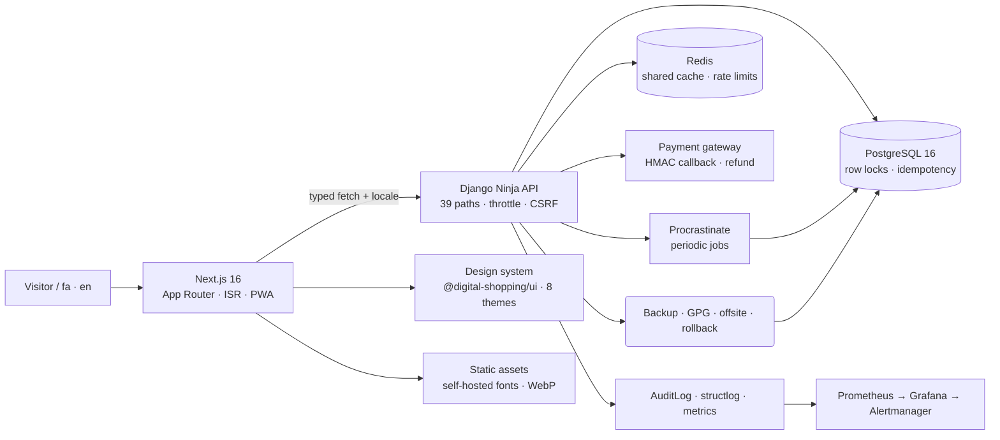

### 4. Checkout flow

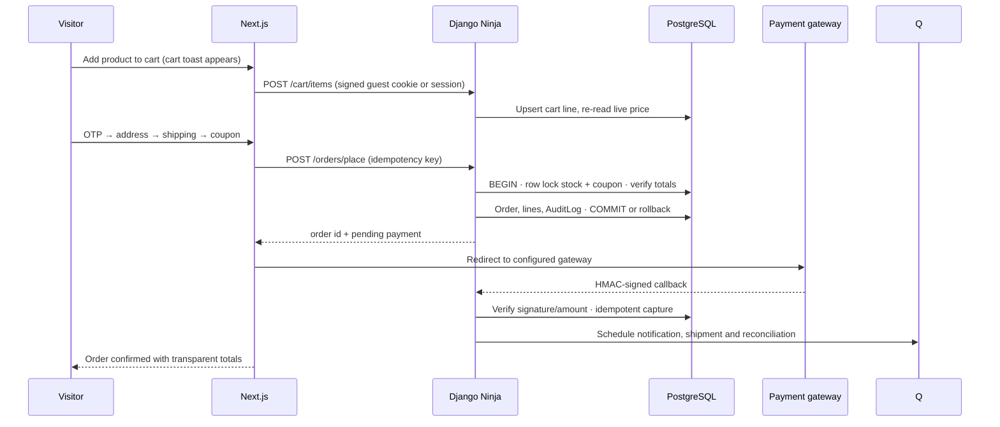

---

### 5. Repository map

```
backend/
  apps/core/        health, metrics, AuditLog, notifications, security, middleware
  apps/accounts/    mobile users, OTP, SMS outbox, passwords, addresses
  apps/catalog/     categories, products, images, rights, reviews, wishlists, API
  apps/pricing/     exchange rate, coupons and money calculations
  apps/orders/      orders, state machine, stock, shipping, returns, shipments
  apps/cart/        guest/user carts, merging and warnings
  apps/payments/    gateway, callback, reconciliation, refunds
  config/settings/  dev / test / test_sqlite / sqlite_local / prod
  tests/            database tests + tests/pure (no Django)
contracts/          openapi.json (39 paths) and test vectors
apps/web/           Next.js: 17 routes, components, lib, fonts, images
packages/ui/        @digital-shopping/ui design system: tokens, 30+ components, tests
overlay/            catalogue source, image-rights ledger and historical previews
ops/                backup, k6, monitoring (Prometheus/Grafana/Alertmanager)
scripts/            security scan, secret rotation, screenshot capture, i18n audit
docs/               ADRs, runbooks, audit reports, design concepts, poster gallery
.github/workflows/  backend-ci, web-ci, ui-ci, security, codeql, dependency-review,
                    link-check, scorecard, pages, images, release, deploy
```

An annotated guide to every top-level directory is in [`docs/REPO-MAP.md`](docs/REPO-MAP.md).

---

### 6. Local setup

Prerequisites: Python 3.12+, Node 22+, PostgreSQL 16 (or Docker) and, optionally, Redis 7.

```bash
# Backend
cd backend
python -m venv .venv && source .venv/bin/activate
pip install -r requirements-dev.txt
cp .env.example .env                       # replace SECRET_KEY and passwords
export DJANGO_SETTINGS_MODULE=config.settings.dev
python manage.py migrate
python manage.py createsuperuser
python manage.py set_exchange_rate 1000000 # orders cannot be placed without a rate
python manage.py import_catalog --dry-run && python manage.py import_catalog
python manage.py runserver
```

```bash
# Frontend
cd apps/web
npm ci
cp .env.example .env.local
npm run dev                                # http://localhost:3000
npm run typecheck && npm run test:e2e
```

```bash
# Design system
cd packages/ui && npm ci
npm run check && npm run preview && npm run e2e
```

API: `GET /api/v1/catalog/products?brand=asus&ram_gte=16&max_usd=1500&sort=price_asc&lang=fa`
Docs: `/api/v1/docs` · Health: `GET /api/v1/health`

A one-click alternative is available through the committed [dev container](.devcontainer/devcontainer.json).

---

### 7. Commands

| Command | Purpose |
|---|---|
| `make up` / `down` / `logs` | Start/stop db + api + worker + caddy |
| `make migrations` / `migrations-check` | Create migrations / verify committed migrations |
| `make migrate` | Apply migrations inside Compose |
| `make test-pure` | 143 database-free tests |
| `make test` / `test-cov` | Full suite / with coverage (80% global, 90% orders and pricing) |
| `make lint` | ruff |
| `make set-rate RATE=…` | Set an exchange rate with typo protection |
| `make data-report` | Report stale prices, unlicensed images and missing rates |
| `make expire-orders` | Manually expire pending orders |
| `make check` | `check --deploy` |
| `npm run dev / build / start / typecheck / lint / test:e2e / lighthouse` | Next.js frontend |
| `npm run check / preview / e2e` | Design system |
| `node scripts/check-i18n.mjs` | Assert that English pages contain no Persian characters |
| `node scripts/capture-screenshots.mjs` | Regenerate the screenshot gallery |

---

### 8. Environment configuration

Complete examples live in `backend/.env.example` and `apps/web/.env.example`. Secrets are never committed.

| Backend variable | Default | Purpose |
|---|---|---|
| `SECRET_KEY`, `DATABASE_URL`, `ALLOWED_HOSTS` | — | Required; production uses `sslmode=require` |
| `DJANGO_SETTINGS_MODULE` | `config.settings.prod` | dev / test / test_sqlite / sqlite_local / prod |
| `DEBUG` | `False` | Fail-closed production checks |
| `CORS_ALLOWED_ORIGINS` / `CSRF_TRUSTED_ORIGINS` | empty | Exact allowlists, never `*` |
| `HIDDEN_BRANDS` | `Starlink` | Brands withheld pending legal review |
| `ORDER_EXPIRY_MINUTES` / `PAYMENT_HOLD_MINUTES` | `15` / `30` | Stock reservation and payment extension |
| `PRICE_STALE_DAYS` | `7` | Stale-price threshold |
| `REQUIRE_IMAGE_LICENSE` | `True` in prod | Unlicensed images block publication |
| `API_THROTTLE_ANON` / `_AUTH` | `300/min` / `600/min` | Rate limits |
| `OTP_SECRET`, `METRICS_TOKEN`, `PAYMENT_CALLBACK_SECRET` | — | Independent random secrets |
| `SMS_GATEWAY`, `SMS_HTTP_URL`, `SMS_HTTP_TOKEN` | `HttpSms` | OTP delivery; console only in dev |
| `PAYMENT_GATEWAY`, `PAYMENT_START_URL`, `PAYMENT_VERIFY_URL`, `PAYMENT_REFUND_URL` | sandbox | Configurable payment provider |
| `RUN_MIGRATIONS` | `1` | `0` in production; migrate separately after backup |
| `REDIS_URL`, `REDIS_PASSWORD` | empty / change-me | Shared cache and Redis password |
| `GRAFANA_ADMIN_PASSWORD`, `ADMIN_ALLOWED_IPS`, `NUM_PROXIES` | — | Operational security |

Frontend: `API_BASE_URL`, `NEXT_PUBLIC_SITE_URL`, `NEXT_PUBLIC_DEFAULT_LOCALE` (`fa`, `en` supported) and `NEXT_PUBLIC_MEDIA_BASE_URL`.
Operations: `METRICS_TOKEN`, `ALERT_WEBHOOK_URL`, `SLACK_WEBHOOK_URL`, `EMAIL_TO`, `BACKUP_DIR`, `BACKUP_GPG_RECIPIENT`, `OFFSITE_TARGET`, `K6_CHECKOUT`, `SENTRY_DSN` and `NEXT_PUBLIC_ANALYTICS_ID` are documented in [`docs/RUNBOOK.md`](docs/RUNBOOK.md) and `ops/monitoring/README.md`.

---

### 9. Domain rules and the money model

- Money is always an integer; final calculations live in `apps/pricing/money.py` and `totals.py`.
- Prices and stock are computed server-side only; `place_order` accepts identifiers, quantities and address/shipping choices — never client-supplied totals.
- **Idempotency:** a UUID key of at most 64 characters is unique per user; a replay with different content returns 409 and stores a fingerprint in `Order.request_hash`.
- Products without a price or image are excluded from the public API; hidden brands are blocked at import and at order time.
- `price_note` marks approximate prices; 23 of 28 products carry such a note.
- Every change to money, stock, status, exchange rate and orders is appended to `AuditLog`.
- `import_catalog` is idempotent, does not overwrite manual status/stock and preserves recorded image rights.

### 10. Job queue and scheduler

- Procrastinate runs on the same PostgreSQL instance (no Redis dependency); its tables are created by `migrate`.
- Periodic jobs: `orders.expire_pending_orders`, `accounts.sms_sweep`, `accounts.cleanup_otp`, `cart.cleanup_old_carts`, `payments.reconcile` and `core.notification_dispatch`.
- Cron alternative: `python manage.py expire_pending_orders` once per minute.
- Worker heartbeat and health checks are configured in Compose.

### 11. Security and operations

- **CORS/CSRF:** exact allowlists; `ApiCsrfMiddleware` covers every write, including the guest cart.
- **Rate limiting:** Ninja throttle on sensitive paths, coordinated through Redis in production.
- **`/admin/`:** protected by Caddy and `AdminGuardMiddleware` with CIDR and `is_staff`.
- **Production checks:** `check --deploy --fail-level WARNING` in CI; the only silenced warning is `security.W021`.
- **Secrets:** gitleaks, rotation procedure and fail-closed behaviour; a leaked secret is revoked, not merely deleted.
- **Monitoring:** `codex_*` metrics, Grafana, eight alerts and a runbook with valid links.
- **Backup:** 15-minute schedule, RPO ≤ 15 minutes and RTO < 1 hour.
- **Deployment:** backup before migration, single migration, API+web health checks and rollback to the previous known-good SHA.

### 12. Data workflows

1. **Exchange rate:** `python manage.py set_exchange_rate RATE`; changes above 20% require `--force` and are audited.
2. **Price freshness:** admin filter or `python manage.py report_data_quality --strict`.
3. **Image rights:** `overlay/data/image-rights.json` is the ledger for 51 images; 49 remain `needs-review`.
4. **Price history:** `snapshot_prices` plus automatic snapshots on catalogue price changes.
5. Before release: `python manage.py report_data_quality --strict` and `report_image_rights --strict`.

### 13. CI/CD and quality

| Workflow | Contents |
|---|---|
| `backend-ci.yml` | ruff → 143 pure tests → migration checks → migrate twice → `check` and `check --deploy` → catalogue dry-run → pytest with coverage and a 90% money-critical gate |
| `ui-ci.yml` | Tokens, 38 contrast pairs, design rules, typecheck, 54 tests and 26 browser tests |
| `web-ci.yml` | `npm ci`, typecheck, build against the port-4000 mock API, 4 E2E tests, i18n audit and Lighthouse budgets |
| `security.yml` | gitleaks, `security_scan.py`, pip-audit and npm audit |
| `codeql.yml` | CodeQL analysis for Python and JavaScript/TypeScript |
| `dependency-review.yml` | Vulnerability and licence policy enforcement on pull requests |
| `link-check.yml` | Monthly and on-demand link validation with lychee |
| `scorecard.yml` | Weekly OpenSSF Scorecard analysis |
| `pages.yml` | Publishes the visual hub and API reference to GitHub Pages |
| `images.yml` | Builds and signs backend/web images in GHCR with SBOMs |
| `release.yml` | Attaches covers, posters and checksums to version tags |
| `deploy.yml` | SSH deploy with backup, migration, health checks and real rollback on tags or dispatch |

**Quality snapshot:** Lighthouse accessibility 100 on `/`, `/products`, `/cart` and `/account`; best practices 100; SEO 100; LCP CI budget 3.5 s with a 2.5 s warning; coverage 93% on orders/pricing; zero findings in gitleaks and pip/npm audit.

### 14. Design system and themes

The visual direction is "spec sheet" (ADR-002): warm paper, dark ink, a single signal colour and hairline rules instead of heavy shadows. Tokens and eight themes live in `packages/ui/src/tokens/tokens.ts`; the Nexus logo is fully recolourable through `--cx-logo-1/2/3`. Components include Button, Modal, Sheet, Gallery, Stepper, Pagination, PriceTag, SpecTable, OrderTimeline, OtpInput and AddressForm. See `packages/ui/README.md` and `packages/ui/docs/COMPONENTS.md`.

### 15. Tests

| Layer | Count | Status |
|---|---|---|
| Backend pytest | 311 passed + 2 skipped | green |
| Pure unittest | 143 | green |
| UI unit/SSR | 54 / 54 | green |
| Web E2E | 4 / 4 | green |
| Preview E2E | 26 / 26 | green |
| ruff / tsc / next build / Lighthouse | — | green |

The two concurrency tests are skipped only on SQLite and run against PostgreSQL in CI.

### 16. Screenshots

| Nebula (default) | Warm Paper | Velvet Night |
|---|---|---|
| 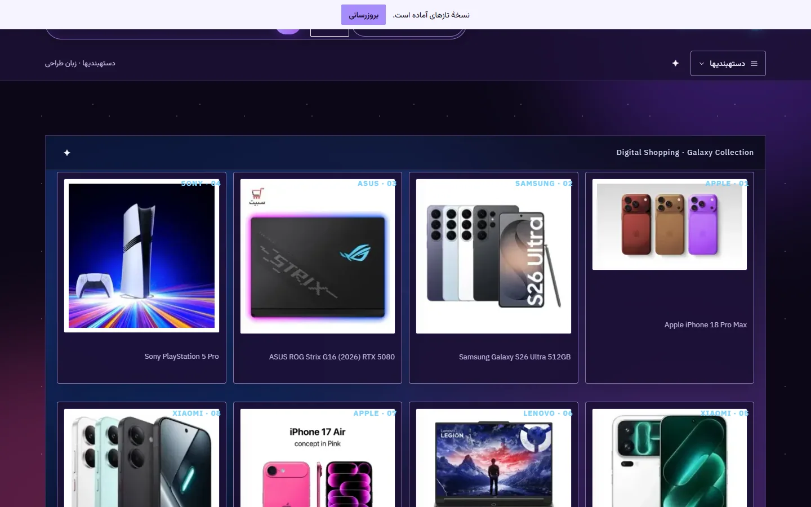 | 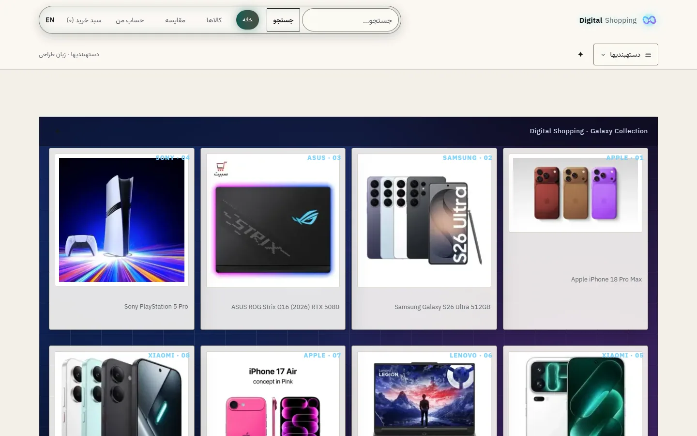 | 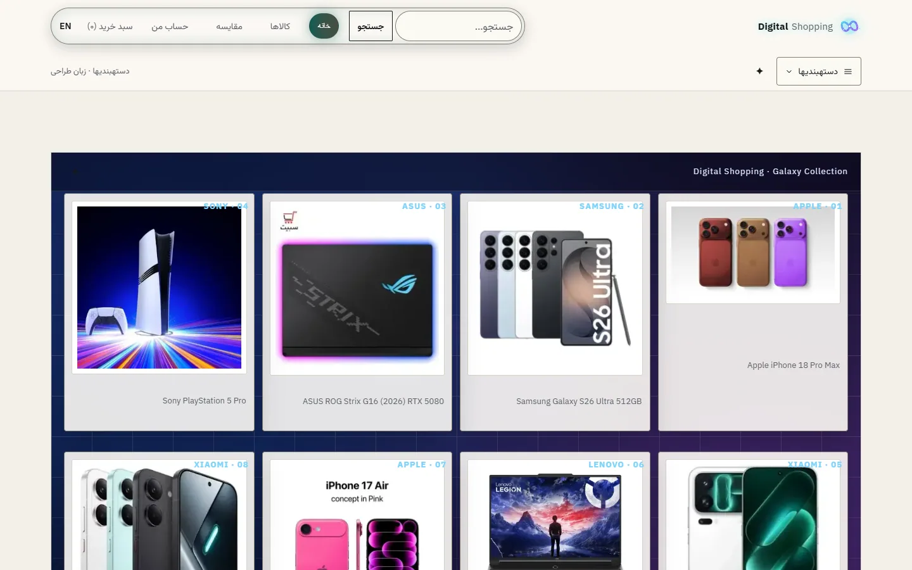 |

| English mode | Catalogue | Cart toast |
|---|---|---|
| 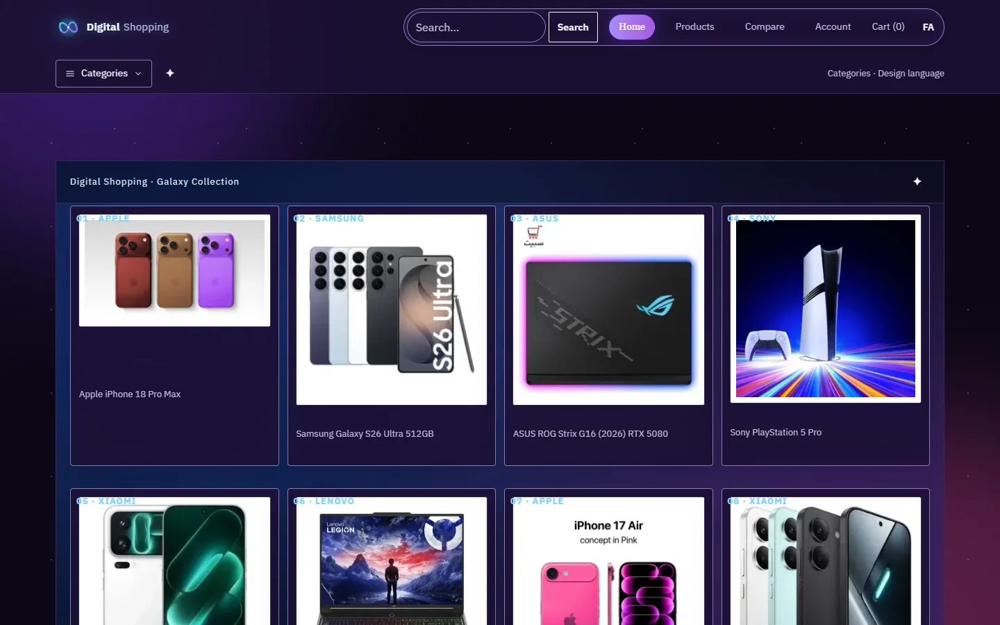 | 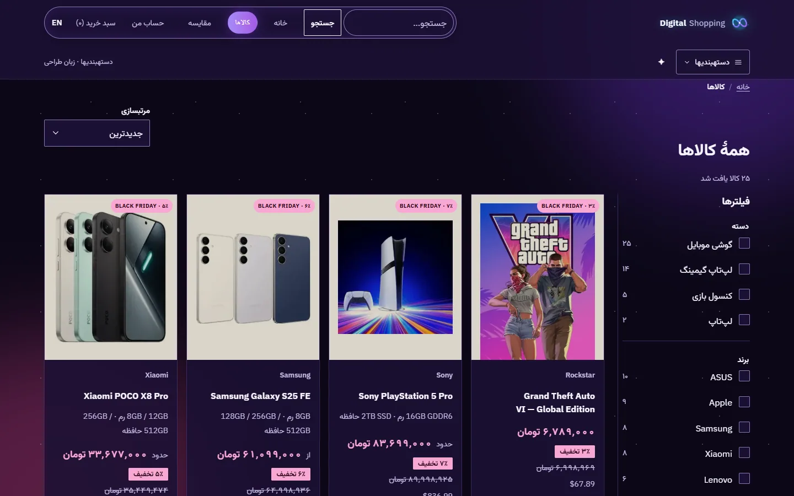 | 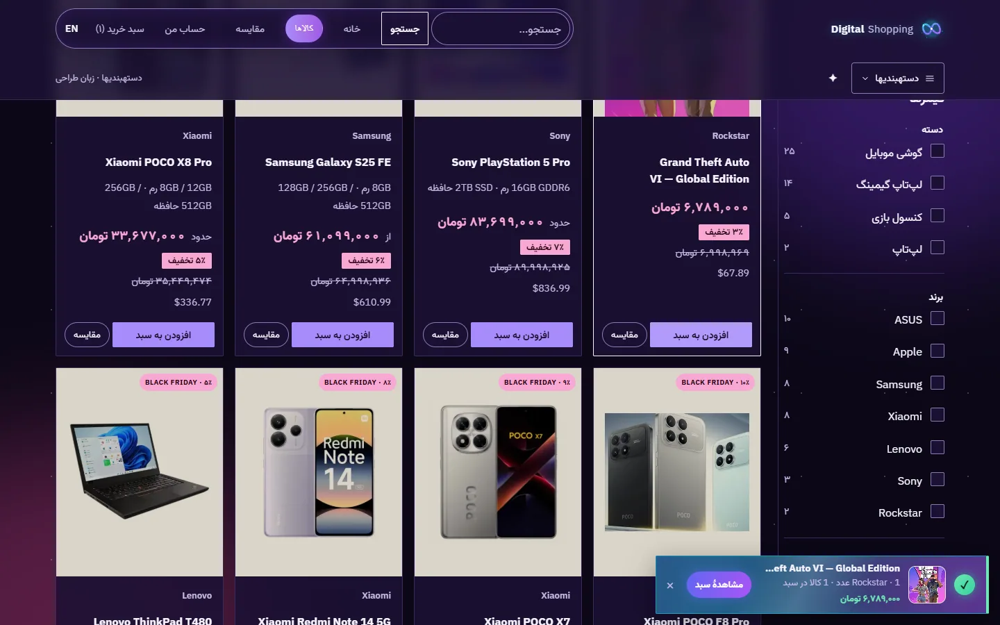 |

| Product detail | Checkout | Mobile |
|---|---|---|
| 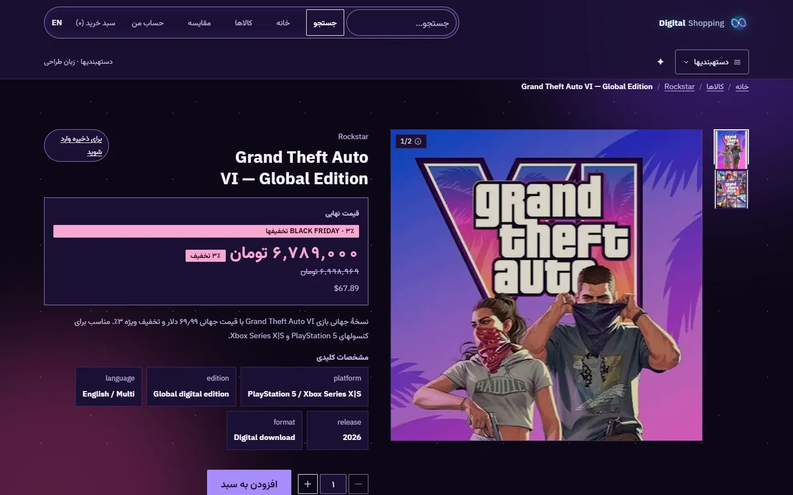 | 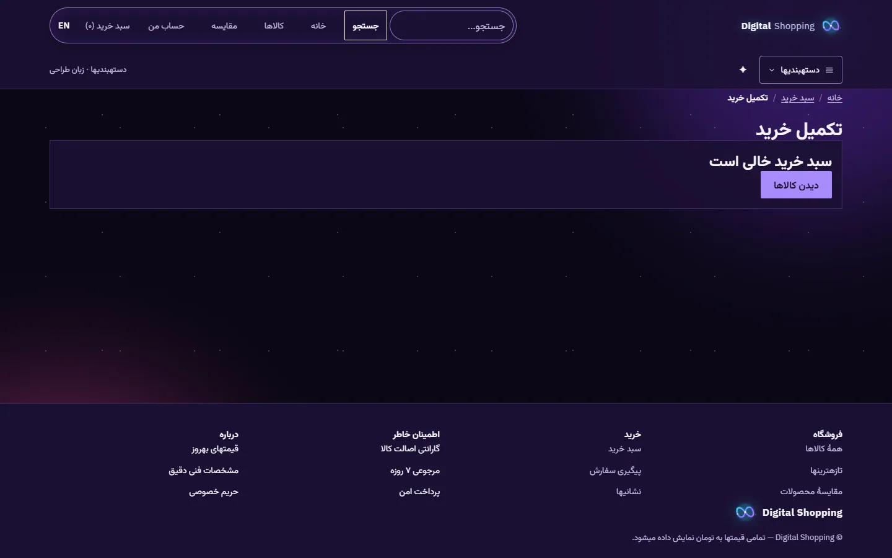 | 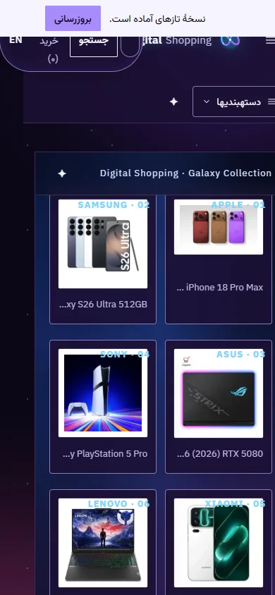 |

All images are reproducible with `node scripts/capture-screenshots.mjs`; the full gallery is at [`docs/screenshots/index.html`](docs/screenshots/index.html).

### 17. Phases and risks

| Phase | Status |
|---|---|
| Visual identity and design system | complete and tested |
| Infrastructure hardening | complete |
| OTP, cart, order API and OpenAPI | complete and tested |
| Sandbox payments and Next.js port | complete; real gateway pending |
| Security, monitoring and backup | baseline implemented; real Sentry pending |
| Deployment, load testing and release | deploy and k6 ready; external credentials required |

**Risks:** 49 of 51 images need rights clearance; 23 prices are approximate; Starlink is hidden by default; real payment and SMS contracts are external. See [`docs/PROJECT-AUDIT-2026-FA.md`](docs/PROJECT-AUDIT-2026-FA.md) and [`docs/IMAGE-RIGHTS.md`](docs/IMAGE-RIGHTS.md).

### 18. License and legal notice

This repository is **public for viewing only**. It is distributed under the **Digital Shopping Source-Available License, Version 1.0**: no right to copy, download, modify, reuse or redistribute the code is granted. Viewing through GitHub is a limited, revocable permission. See [LICENSE](LICENSE) and [docs/LEGAL.md](docs/LEGAL.md) for the full terms, third-party licences and the historical MIT revision note. Product images and fonts carry their own provenance and licence records.

### 19. Documentation and contribution

- [CHANGELOG](docs/CHANGELOG.md) · [ROADMAP](docs/ROADMAP.md) · [SLO](docs/SLO.md) · [RUNBOOK](docs/RUNBOOK.md)
- [Full audit report](docs/PROJECT-AUDIT-2026-FA.md) · [GitHub setup guide](docs/GITHUB-SETUP.md) · [Repository map](docs/REPO-MAP.md)
- [ADRs](docs/adr/README.md) · [Design language](docs/DESIGN-LANGUAGE.md) · [Galaxy themes](docs/GALAXY-THEMES-FA.md)
- [Logo concepts](docs/LOGO-CONCEPTS-2026-FA.md) · [Visual logo preview](docs/logo-concepts/final-preview.html)
- [Poster gallery](docs/github-posters/index.html) · [Visual hub](docs/index.html) · [API reference](docs/api.html) — **live at https://mfcatash.github.io/digital-shopping/**
- [Contributing guide](CONTRIBUTING.md) · [Code of conduct](CODE_OF_CONDUCT.md) · [Security policy](docs/SECURITY.md) · [Privacy and demo terms](docs/PRIVACY.md)

**Concluding note.** Digital Shopping shows that an electronics storefront can be both rigorously engineered and deeply human: a place where every price carries a history, every image carries a provenance, every order carries a fingerprint, and every interface carries a language and an identity. This repository is not merely code — it is a system that treats transparency as a product feature and quality as an operating discipline, built with engineering rigour, protected by tests, and shaped by respect for the person at the other end of the screen.

---

<a id="فارسی"></a>

## فارسی

**فروشگاهی دیجیتال با قیمت شفاف، مشخصات استاندارد و تجربهای که بهزبان فارسی و انگلیسی، در هر تم و بر هر دستگاهی یکسان میدرخشد.**

> وضعیت (۲۷ نوامبر ۲۰۲۶): بکاند و فرانت کاملاً پیاده، آزموده و منتشر شدهاند. **۳۱۱ تست بکاند Passed + ۲ Skipped** (دو تست همزمانی نیازمند Postgres و روی SQLite رد میشوند) · **۱۴۳ تست خالص** · **۵۴ تست UI** · **۲۶ تست E2E پیشنمایش** · **۴ تست E2E وب**. قرارداد API دارای **۳۹ مسیر**، کاتالوگ **۲۸ محصول / ۵۱ تصویر**، رابط **۱۷ مسیر** و **۸ تم** است. تمام migrationها کامیتاند؛ `ruff`، `tsc`، `next build`، Lighthouse و تمام گردشکارها سبزاند.

Digital Shopping یک فروشگاه الکترونیکی تمامپیشه است که «قیمت واقعی، مقایسۀ واقعی» را اصل طراحی خود قرار میدهد. این پروژه ترکیبی است از بکاند Django با معماری امن و تراکنشمحور، فرانت Next.js دوزبان با هویت بصری اختصاصی، و لایهای از عملیات شامل CI/CD، مانیتورینگ، پشتیبانگیری رمزگذاری شده و بازگشت قابل اثبات. هدف تنها نمایش کالا نیست، بلکه **ایجاد اعتماد قابلاندازهگیری** از طریق تاریخچۀ قیمت، مشخصات استاندارد، شفافسازی مالیات و حملونقل، گزارش صادقانه حقوق تصاویر و ممیزی فقطافزودنی مالی است.

### فهرست

1. [فناوریها و کتابخانهها](#۱-فناوریها-و-کتابخانهها)
2. [قابلیتها و امکانات](#۲-قابلیتها-و-امکانات)
3. [معماری](#معماری)
4. [جریان چکاوت](#جریان-چکاوت)
5. [ساختار مخزن](#۳-ساختار-مخزن)
6. [راهاندازی محلی](#۴-راهاندازی-محلی)
7. [دستورها](#۵-دستورها)
8. [تنظیمات محیطی](#۶-تنظیمات-محیطی)
9. [قواعد دامنه و مدل مالی](#۷-قواعد-دامنه-و-مدل-مالی)
10. [صف کار و زمانبند](#۸-صف-کار-و-زمانبند)
11. [امنیت و عملیات](#۹-امنیت-و-عملیات)
12. [گردش کار داده](#۱۰-گردش-کار-داده)
13. [CI/CD و کیفیت](#۱۱-cicd-و-کیفیت)
14. [سیستم طراحی و تمها](#۱۲-سیستم-طراحی-و-تمها)
15. [تستها](#۱۳-تستها)
16. [تصاویر](#تصاویر)
17. [وضعیت فازها و ریسکها](#۱۴-وضعیت-فازها-و-ریسکها)
18. [مجوز و اطلاع حقوقی](#۱۵-مجوزها-و-داراییها)
19. [اسناد و مشارکت](#۱۶-اسناد-و-مشارکت)

---

### ۱. فناوریها و کتابخانهها

| زبان | کاربرد |
|---|---|
| **Python** | بکاند Django، سرویسها، تستها، ابزار امنیتی و مهاجرت داده |
| **TypeScript / JavaScript** | فرانت Next.js، بستهٔ طراحی `@digital-shopping/ui`، اسکریپتهای Preview و E2E |
| **CSS** | توکنهای طراحی، سیستم ۸ تم، چیدمان واکنشگرا و انیمیشن |
| **SQL** | مهاجرتهای Django و کوئریهای عملیاتی |
| **Bash / PowerShell** | استقرار، بکاپ، چرخش رازها و اسکریپتهای محلی |

| بکاند | نسخه / نقش |
|---|---|
| Django | `>=5.1,<5.3` (آزمودهشده با ۵٫۲٫۱۹) |
| Django Ninja | `>=1.3,<2` — API تایپشده با OpenAPI خودکار و ۳۹ مسیر |
| PostgreSQL | ۱۶ — قفل ردیفها، advisory lock و idempotency |
| psycopg | `>=3.2,<4` |
| django-environ | خواندن ایمن متغیرهای محیطی |
| django-cors-headers | CORS با allowlist دقیق |
| Procrastinate | صف کار و وظایف periodic همان روی Postgres |
| structlog | لاگ JSON ساختاریافته همراه Request-ID |
| Gunicorn / Whitenoise | سرور WSGI با ۳ worker / ارائۀ استاتیک |
| Redis | اختیاری در توسعه، الزامی در production برای کش و محدودیت نرخ |
| Caddy | Reverse proxy، HTTPS خودکار، HSTS و CSP |

| فرانتاند | نسخه / نقش |
|---|---|
| Next.js | `^16` — App Router، ISR، Server Components، metadata و sitemap |
| React | `^19` |
| TypeScript | `^5.6` |
| `@digital-shopping/ui` | بستهٔ طراحی داخلی با ۳۰+ کامپوننت |
| GSAP + ScrollTrigger | انیمیشن کیهانی با احترام به `prefers-reduced-motion` |
| `next/image` | بهینهسازی تصاویر و srcset پاسخگو |
| Playwright | ۴ تست E2E وب و ۲۶ تست رفتاری پیشنمایش |
| Lighthouse CI | بودجههای عملکرد، دسترسپذیری و SEO |
| Intl API | قالببندی تاریخ و اعداد برای fa/en |

**طراحی، ابزار و عملیات:** فونتهای self-hosted Vazirmatn و IBM Plex تحت SIL OFL 1.1؛ تصاویر WebP (جلد GTA VI در ۱۸۶۰×۲۶۳۶)؛ pytest و pytest-cov با آستانۀ ۸۰٪ کل و ۹۰٪ منطق پول؛ ruff، `tsc --noEmit`، design-linter و contrast-checker داخلی؛ gitleaks، pip-audit و npm audit؛ Prometheus، Grafana و Alertmanager با ۱۰ متریک و ۸ هشدار؛ سناریوی بار k6؛ استقرار Docker Compose با ۱۱ سرویس، بکاپ پیش از migration و rollback واقعی.

---

### ۲. قابلیتها و امکانات

#### ۲٫۱ هویت بصری و تجربۀ کاربری
- **لوگوی «حلقۀ نکسوس»:** نماد SVG سهبعدی با روبانهای درهمتنیده، هالۀ ذرهای، نقطۀ نور متحرک و تایپوگرافی دووزن `Digital` / `Shopping`؛ کاملاً هماهنگ با تمها.
- **۸ تم کامل:** Nebula Violet (پیشفرض)، Aurora Mint، Solar Gold، Ocean Blue، Rose Nebula، Cosmic Silver، کاغذ گرم و شب مخملی — رنگ لوگو، هاله، کارتها و پسزمینه از متغیرهای CSS پیروی میکنند.
- **پسزمینۀ کیهانی پویا:** GSAP + ScrollTrigger با دو کرۀ نوری؛ در `prefers-reduced-motion` بهحالت ایستا تبدیل میشود.
- **منوی ترکیبی:** Glass Dock، Pill Navigation و Neon Serif همراه منوی هوشمند دستهبندی با Escape/outside-click و ARIA.
- **کاور خانه:** ۸ محصول واقعی با تصاویر یکاندازه و بدون برش، همراه ۶ مسیر ناوبری سریع.
- **اعلان ویژۀ سبد:** کارت رنگارنگ با تصویر، نام، برند، تعداد،قیمت و دکمۀ «مشاهدۀ سبد»، دوزبان و با بستهشدن خودکار.
- **PWA:** manifest، service worker network-first، نصب اپ، حالت آفلاین، بنر بروزرسانی و ذخیرۀ مسیرهای کلیدی.

#### ۲٫۲ کاتالوگ و محصول
- ۲۸ محصول / ۵۱ تصویر / ۵ دستهبندی دوزبان.
- **فیلترها و فستها:** برند، دسته، RAM، حافظه، مشخصات، قیمت، موجودی، تخفیف و مرتبسازی.
- جستجوی پیشنهادی Debounced، محصولات مرتبط و مقایسه تا ۴ کالا.
- **تاریخچۀ قیمت** با نمودار step و نویسندۀ خودکار هنگام تغییر قیمت.
- امتیاز، لیست نظرات و فرم ثبت نظر.
- محصول شاخص: **Grand Theft Auto VI — Global Edition** با دو جلد HD ارسالشده توسط کاربر.
- برچسب **BLACK FRIDAY** با تخفیف ۳–۱۰٪.
- محافظت از آگهی بدون قیمت یا عکس و مسدودسازی برندهای مخفی.

#### ۲٫۳ سبد، سفارش و خرید
- سبد مهمان با کوکی امضا شده، ادغام با سبد کاربر پس از ورود، محدودیت تعداد و هشدار تغییر قیمت/موجودی.
- خط سبد شفاف: برند، مشخصات، قیمت قبل/بعد تخفیف، درصد تخفیف و جمع خط.
- چکاوت چهارمرحلهای: OTP ← نشانی ← حملونقل ← پرداخت/کوپن ← ثبت سفارش.
- **سفارش اتمیک** با row lock، idempotency، اثر انگشت درخواست و جلوگیری از Oversell.
- ماشین حالت سفارش، انقضای ۱۵دقیقهای، لغو و بازگشت موجودی.
- **کوپن** با قفل ردیفها، محدودیت usage و اعتبارسنجی پیش از پرداخت.
- **حملونقل و مالیات** جداگانه (VAT ۱۰٪) و ثبت در `AuditLog`.
- **مرجوعی** با ثبت درخواست، شاخههای تأیید و بازپرداخت واقعی gateway.
- **Shipment** با سرویس ساخت/پیشرفت و اقدامات ادمین.

#### ۲٫۴ حساب کاربری و احراز هویت
- ورود بدون رمز با **OTP ششرقمی** (HMAC-SHA256، `compare_digest`، ممنوعیت استفادهٔ مجدد).
- نشست کوکی (نه JWT)، چرخش شناسه نشست، تنظیم/تغییر/بازنشانی رمز.
- دفتر نشانیها با پیشفرض، استان و کدپستی اعتبارسنجیشده؛ علاقهمندیها، سفارشها، بازگشتها و اعلانها.
- محدودیت نرخ OTP و رمز + بکآف تصاعدی پیامک.
- مرکز اعلان درونبرنامهای با علامتخواندن تکی/همگانی و ارسال دورهای.

#### ۲٫۵ پرداخت و مغایرتگیری
- رابط قابلتنظیم (`HttpGateway`)، `FakeGateway` برای sandbox و callback امن با HMAC.
- تطبیق مبلغ، idempotency کلیک مکرر و ثبت `needs_review` هنگام مغایرت.
- تسویۀ دورهای، بازپرداخت واقعی gateway و ثبت خطاهای refund.
- عدم ذخیرۀ اطلاعات کارت؛ خام callback تنها در `AuditLog`.

#### ۲٫۶ دوزبانگی fa/en
- **دیکشنری ۱:۱** با صدها کلید و تست `missingKeys`.
- کوکی `cx_locale` همراه `lang`/`dir` سمت سرور؛ SSR براساس زبان کاربر.
- قالببندی locale-aware: اعداد لاتین/فارسی، `IRR`/تومان، تاریخ میلادی/شمالی و عبارات انگلیسی `From`، `Approx.`، `% off` و `Previous price`.
- ترجمۀ کامل ۱۴ صفحه، پیامهای خطای بکاند و برچسبهای ARIA — **حالت en بدون حتی یک کاراکتر فارسی**.
- `GlobalTranslator` بهعنوان پوشش نهایی بدون دستکاری ورودیهای کنترلشده.

#### ۲٫۷ امنیت، کیفیت و عملیات
- CSRF بر تمام نوشتارها، CORS allowlist، محافظت `/admin/` با CIDR و `is_staff`.
- چکهای fail-closed (E001–E031)، `compare_digest` برای توکن متریک، لاگ بدون PII و Request-ID امن.
- gitleaks، Dependabot، الگوهای Issue/PR، محافظت شاخه و استقرار با بکاپ و rollback واقعی.
- بکاپ ۱۵دقیقهای با رمزگذاری GPG و مقصد offsite، SLO/RUNBOOK و ۸ هشدار با لینک معتبر.

---

### معماری

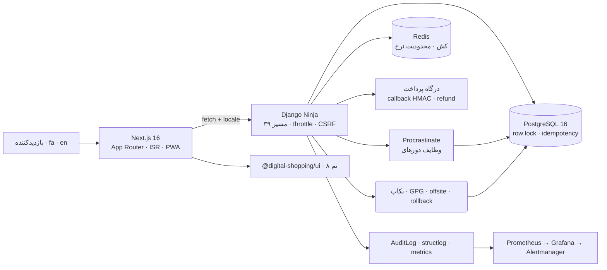

### جریان چکاوت

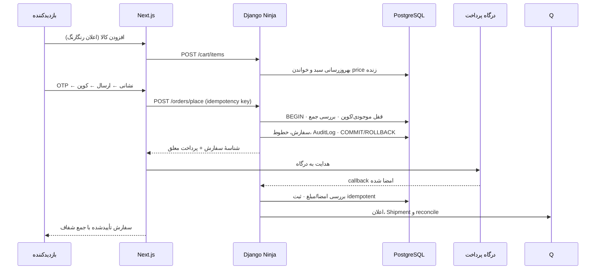

---

### ۳. ساختار مخزن

```
backend/apps/core|accounts|catalog|pricing|orders|cart|payments
backend/config/settings/   dev / test / test_sqlite / sqlite_local / prod
backend/tests/             تست دیتابیسی + tests/pure
contracts/                 openapi.json (۳۹ مسیر)
apps/web/                  Next.js: ۱۷ مسیر، components، lib، فونتها
packages/ui/               @digital-shopping/ui: توکنها، ۳۰+ کامپوننت
overlay/                   منبع کاتالوگ، دفتر حقوق عکس، پیشنمایش تاریخی
ops/                       backup، k6، monitoring
scripts/                   security_scan، rotate-secrets، capture-screenshots، check-i18n
docs/                      CHANGELOG، ROADMAP، SLO، RUNBOOK، ADR، اسناد طراحی
.github/workflows/          CI امنیت، معماری، صفحات، ایمیجز، release و deploy
```

راهنمای کامل: [`docs/REPO-MAP.md`](docs/REPO-MAP.md).

---

### ۴. راهاندازی محلی

پیشنیازها: Python 3.12+، Node 22+، PostgreSQL 16 (یا Docker) و در صورت تمایل Redis 7.

```bash
cd backend
python -m venv .venv && source .venv/bin/activate
pip install -r requirements-dev.txt
cp .env.example .env
export DJANGO_SETTINGS_MODULE=config.settings.dev
python manage.py migrate
python manage.py createsuperuser
python manage.py set_exchange_rate 1000000
python manage.py import_catalog --dry-run && python manage.py import_catalog
python manage.py runserver
```

```bash
cd apps/web
npm ci
cp .env.example .env.local
npm run dev                                # http://localhost:3000
npm run typecheck && npm run test:e2e
```

```bash
cd packages/ui && npm ci
npm run check && npm run preview && npm run e2e
```

API: `GET /api/v1/catalog/products?brand=asus&ram_gte=16&max_usd=1500&sort=price_asc&lang=fa`
مستندات: `/api/v1/docs` · سلامت: `GET /api/v1/health`. جایگزین یککلیک: [dev container](.devcontainer/devcontainer.json).

---

### ۵. دستورها

| دستور | کار |
|---|---|
| `make up` / `down` / `logs` | بالا آوردن db + api + worker + caddy |
| `make migrations` / `migrations-check` | ساخت/بررسی migrationها |
| `make test-pure` | ۱۴۳ تست بدون دیتابیس |
| `make test` / `test-cov` | تست کامل / با پوشش (۸۰٪ کل، ۹۰٪ orders/pricing) |
| `make lint` | ruff |
| `make set-rate RATE=…` | ثبت نرخ ارز با محافظ اشتباه تایپی |
| `make data-report` | گزارش قیمت قدیمی، عکس بدون مجوز و نبود نرخ |
| `npm run dev / build / start / typecheck / lint / test:e2e / lighthouse` | فرانت |
| `node scripts/check-i18n.mjs` | اثبات نبود کاراکتر فارسی در صفحات en |
| `node scripts/capture-screenshots.mjs` | تولید مجدد گالری تصاویر |

---

### ۶. تنظیمات محیطی

نمونههای کامل: `backend/.env.example` و `apps/web/.env.example`؛ رازها هرگز کامیت نمیشوند. متغیرهای اصلی بکاند: `SECRET_KEY`، `DATABASE_URL`، `ALLOWED_HOSTS`، `DJANGO_SETTINGS_MODULE`، `DEBUG`، `CORS_ALLOWED_ORIGINS`، `CSRF_TRUSTED_ORIGINS`، `HIDDEN_BRANDS`، `ORDER_EXPIRY_MINUTES`، `PRICE_STALE_DAYS`، `REQUIRE_IMAGE_LICENSE`، `OTP_SECRET`، `METRICS_TOKEN`، `PAYMENT_CALLBACK_SECRET`، `SMS_*`، `PAYMENT_*`، `RUN_MIGRATIONS`، `REDIS_URL/PASSWORD` و تنظیمات امنیتی Grafana/Admin.
فرانت: `API_BASE_URL`، `NEXT_PUBLIC_SITE_URL`، `NEXT_PUBLIC_DEFAULT_LOCALE`، `NEXT_PUBLIC_MEDIA_BASE_URL`.
عملیات: `ALERT_WEBHOOK_URL`، `SLACK_WEBHOOK_URL`، `BACKUP_DIR`، `BACKUP_GPG_RECIPIENT`، `OFFSITE_TARGET`، `K6_CHECKOUT`، `SENTRY_DSN` — مستند در [`docs/RUNBOOK.md`](docs/RUNBOOK.md).

---

### ۷. قواعد دامنه و مدل مالی

- پول همواره عدد صحیح است؛ محاسبه در `apps/pricing/money.py` و `totals.py`.
- price و موجودی فقط سمت سرور؛ `place_order` تنها شناسه، تعداد و نشانی/روش ارسال میپذیرد.
- **idempotency:** کلید UUID حداکثر ۶۴ کاراکتر فقط در همان کاربر یکتا؛ تکرار با محتوای متفاوت ۴۰۹ و اثر انگشت در `Order.request_hash`.
- آگهی بدون قیمت یا عکس در API عمومی ظاهر نمیشود؛ برند مخفی در import و سفارش مسدود است.
- `price_note` price تقریبی را مشخص میکند؛ ۲۳ از ۲۸ محصول چنین یادداشتی دارند.
- تمام تغییرات پول، موجودی، وضعیت، نرخ و سفارش در `AuditLog` فقطافزودنی ثبت میشوند.
- `import_catalog` idempotent است، وضعیت/موجودی دستی را بازنویسی نمیکند و مجوز عکسها را حفظ میکند.

### ۸. صف کار و زمانبند

- Procrastinate روی همان Postgres؛ جداول توسط `migrate` ساخته میشوند.
- وظایف دورهای: انقضای سفارش، SMS sweep، پاکسازی OTP و سبد، reconcile پرداخت و ارسال اعلانها.
- جایگزین cron: `python manage.py expire_pending_orders` هر دقیقه.
- worker heartbeat و healthcheck در Compose تنظیماند.

### ۹. امنیت و عملیات

- CORS/CSRF allowlist دقیق؛ `ApiCsrfMiddleware` تمام نوشتارها حتی سبد مهمان را میپوشاند.
- محدودیت نرخ Ninja، هماهنگشده با Redis در production.
- `/admin/` تحت Caddy و `AdminGuardMiddleware` با CIDR و `is_staff`.
- `check --deploy --fail-level WARNING` در CI؛ تنها هشدار خاموششده `security.W021`.
- رازها: gitleaks، چرخش و fail-closed؛ راز لو رفته باطل میشود.
- مانیتورینگ: متریکهای `codex_*`، Grafana، ۸ هشدار و RUNBOOK.
- بکاپ ۱۵دقیقهای، RPO ≤ ۱۵ دقیقه و RTO < ۱ ساعت.
- استقرار: بکاپ قبل migrate، migrate تکبار، بررسی سلامت API+وب و rollback به SHA قبلی.

### ۱۰. گردش کار داده

1. نرخ ارز: `set_exchange_rate`؛ تغییر بالای ۲۰٪ نیازمند `--force` و ثبت در AuditLog.
2. تازگیprice: فیلتر ادمین یا `report_data_quality --strict`.
3. مجوز عکس: `overlay/data/image-rights.json`؛ ۴۹ مورد `needs-review`اند.
4. تاریخچۀ قیمت: `snapshot_prices` و ثبت خودکار هنگام تغییر قیمت.
5. پیش از انتشار: `report_data_quality --strict` و `report_image_rights --strict`.

### ۱۱. CI/CD و کیفیت

| گردشکار | محتوا |
|---|---|
| `backend-ci.yml` | ruff، تست خالص، migration check، migrate دو بار، `check`، dry-run کاتالوگ، pytest و گیت پوشش ۹۰٪ |
| `ui-ci.yml` | توکنها، ۳۸ جفت کنتراست، قواعد طراحی، typecheck، ۵۴ تست و ۲۶ تست مرورگر |
| `web-ci.yml` | npm ci، typecheck، build با mock API پورت ۴۰۰۰، ۴ E2E، تست i18n و Lighthouse |
| `security.yml` | gitleaks، security_scan، pip-audit و npm audit |
| `codeql.yml` | تحلیل CodeQL برای Python و TypeScript/JavaScript |
| `dependency-review.yml` | بررسی آسیبپذیری و مجوز وابستگیها در PRها |
| `link-check.yml` | بررسی لینکها با lychee بهصورت ماهانه و درخواستی |
| `scorecard.yml` | تحلیل هفتگی OpenSSF Scorecard |
| `pages.yml` | انتشار هاب بصری و مستندات API در GitHub Pages |
| `images.yml` | ساخت و امضای ایمیجز در GHCR همراه SBOM |
| `release.yml` | پیوست کاورها، پوسترها و checksum به تگها |
| `deploy.yml` | استقرار SSH با بکاپ، migration، بررسی سلامت و rollback |

**نمای کیفیت:** دسترسپذیری Lighthouse برابر ۱۰۰ در چهار صفحۀ اصلی، best-practices ۱۰۰، SEO ۱۰۰، بودجه LCP معیار ۳٫۵ ثانیه با هشدار ۲٫۵ ثانیه، پوشش ۹۳٪ در orders/pricing و صفر یافته در gitleaks و auditها.

### ۱۲. سیستم طراحی و تمها

جهت بصری «برگۀ مشخصات» (ADR-002): کاغذ گرم، جوهر تیره، رنگ سیگنال منفرد و خط نازک بهجای سایۀ سنگین. توکنها و ۸ تم در `packages/ui/src/tokens/tokens.ts`؛ لوگوی Nexus از طریق `--cx-logo-1/2/3` رنگپذیر است. کامپوننتها: Button، Modal، Sheet، Gallery، Stepper، Pagination، PriceTag، SpecTable، OrderTimeline، OtpInput و AddressForm.

### ۱۳. تستها

| لایه | تعداد | وضعیت |
|---|---|---|
| بکاند pytest | ۳۱۱ Passed + ۲ Skipped | سبز |
| تست خالص | ۱۴۳ | سبز |
| UI unit/SSR | ۵۴ / ۵۴ | سبز |
| E2E وب | ۴ / ۴ | سبز |
| E2E پیشنمایش | ۲۶ / ۲۶ | سبز |
| ruff / tsc / build / Lighthouse | — | سبز |

---

### تصاویر

| Nebula (پیشفرض) | کاغذ گرم | شب مخملی |
|---|---|---|
|  |  |  |

| حالت انگلیسی | کاتالوگ | اعلان سبد |
|---|---|---|
|  |  |  |

| صفحۀ محصول | چکاوت | موبایل |
|---|---|---|
|  |  |  |

گالری کامل: [`docs/screenshots/index.html`](docs/screenshots/index.html)؛ تولید مجدد با `node scripts/capture-screenshots.mjs`.

---

### ۱۴. وضعیت فازها و ریسکها

| فاز | وضعیت |
|---|---|
| هویت بصری و سیستم طراحی | انجام و آزموده |
| تثبیت زیربنا | انجام |
| OTP، سبد، API سفارش و OpenAPI | انجام و آزموده |
| پرداخت sandbox و پورت Next | انجام؛ درگاه واقعی باقی ماند |
| امنیت، مانیتورینگ و بکاپ | پایه پیاده؛ Sentry واقعی باقی ماند |
| استقرار، بار و انتشار | deploy و k6 آماده؛ credential خارجی لازم است |

**ریسکها:** ۴۹ از ۵۱ عکس نیاز به تأیید حقوقی دارند؛ ۲۳ قیمت تقریبیاند؛ Starlink پیشفرض پنهان است؛ درگاه و SMS واقعی نیازمند قرارداد خارجیاند. جزئیات: [`docs/PROJECT-AUDIT-2026-FA.md`](docs/PROJECT-AUDIT-2026-FA.md) و [`docs/IMAGE-RIGHTS.md`](docs/IMAGE-RIGHTS.md).

---

### ۱۵. مجوزها و داراییها

- **کد:** لایسنس اختصاصی **Digital Shopping Source-Available v1.0** — مخزن عمومی و **فقط قابل مشاهده**؛ هیچ اجازهای برای کپی، دانلود، تغییر یا استفاده داده نمیشود. متن کامل: [`LICENSE`](LICENSE) و [`docs/LEGAL.md`](docs/LEGAL.md).
- **فونتها:** SIL OFL 1.1 — `apps/web/public/fonts/LICENSES.txt`.
- **تصاویر:** `docs/ASSET-PROVENANCE.md`، `docs/IMAGE-RIGHTS.md` و `overlay/data/image-rights.json`.
- **اسناد امنیتی:** `docs/SECURITY.md`، `docs/SECRETS-ROTATION.md` و `docs/SECURITY-AUDIT-REPORT-FA.md`.

---

### ۱۶. اسناد و مشارکت

- [CHANGELOG](docs/CHANGELOG.md) · [ROADMAP](docs/ROADMAP.md) · [SLO](docs/SLO.md) · [RUNBOOK](docs/RUNBOOK.md)
- [گزارش آنالیز جامع](docs/PROJECT-AUDIT-2026-FA.md) · [راهنمای GitHub](docs/GITHUB-SETUP.md) · [نقشۀ مخزن](docs/REPO-MAP.md)
- [ADRها](docs/adr/README.md) · [زبان طراحی](docs/DESIGN-LANGUAGE.md) · [تمها](docs/GALAXY-THEMES-FA.md)
- [کانسپت لوگو](docs/LOGO-CONCEPTS-2026-FA.md) · [پیشنمایش بصری لوگو](docs/logo-concepts/final-preview.html)
- [کاورها و پوسترها](docs/github-posters/index.html) · [هاب بصری](docs/index.html) · [مستندات API](docs/api.html) — **نسخۀ زنده: https://mfcatash.github.io/digital-shopping/**
- [راهنمای مشارکت](CONTRIBUTING.md) · [آییننامه](CODE_OF_CONDUCT.md) · [سیاست امنیتی](docs/SECURITY.md) · [حریم خصوصی](docs/PRIVACY.md)

**سخن پایانی.** Digital Shopping ثابت میکند که یک فروشگاه الکترونیکی میتواند هم **دقیق و مهندسی** باشد و هم **زیبا و انسانی**: جایی که هر price دارایhistory، هر تصویر دارای منبع، هر سفارش دارای اثر انگشت و هر رابط دارای هویت و زبان است. این مخزن تنها کد نیست، بلکه سیستمی قابلاعتماد است که شفافیت را بهعنوان قابلیت محصول و کیفیت را بهعنوان قاعدهای عملیاتی در نظر میگیرد — پروژهای با نظم مهندسی ساختهشده، با تستها محافظت شده و با احترام به کاربر نهایی به نقطۀ اعتماد رسیده است.
