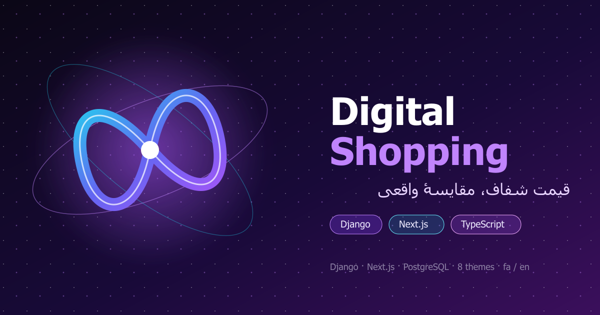

# Digital Shopping



[](https://github.com/MFCAtash/digital-shopping/actions/workflows/backend-ci.yml)
[](https://github.com/MFCAtash/digital-shopping/actions/workflows/web-ci.yml)
[](https://github.com/MFCAtash/digital-shopping/actions/workflows/ui-ci.yml)
[](https://github.com/MFCAtash/digital-shopping/actions/workflows/security.yml)
[](LICENSE)

**فروشگاهی دیجیتال با قیمت شفاف، مشخصات استاندارد و تجربهای که بهزبان فارسی و انگلیسی، در هر تم و بر هر دستگاهی یکسان میدرخشد.**

> وضعیت (۲۶ نوامبر ۲۰۲۶): بکاند و فرانت کاملاً پیاده، آزموده و برای GitHub آمادهاند.
> **۳۱۱ تست بکاند Passed + ۲ Skipped** (دو تست همزمانی روی SQLite؛ CI با Postgres اجرا میکند) · **۱۴۳ تست خالص** · **۵۴ تست UI** · **۲۶ تست E2E پیشنمایش** · **۴ تست E2E وب**.
> قرارداد API دارای **۳۹ مسیر**، کاتالوگ **۲۸ محصول / ۵۱ تصویر**، رابط دارای **۱۷ مسیر** و **۸ تم** (۶ تم کهکشانی + کاغذ گرم / شب مخملی) است.
> تمام migrationها کامیتاند و در CI دو بار بررسی میشوند؛ `ruff`، `tsc`، `next build` و تمام تستها سبزاند.

---

## معرفی

Digital Shopping یک فروشگاه الکترونیکی تمامپیشه است که «قیمت واقعی، مقایسهٔ واقعی» را بهعنوان اصل طراحی خود قرار میدهد. این پروژه ترکیبی است از یک بکاند Django با معماری امن و تراکنشمحور، یک فرانت Next.js دوزبانه با هویت بصری اختصاصی، و لایهای از عملیات شامل CI/CD، مانیتورینگ، پشتیبانگیری و استقرار قابل بازگشت. هدف آن تنها نمایش کالا نیست، بلکه **ایجاد اعتماد قابلاندازهگیری** از طریق ثبت تاریخچهٔ قیمت، نشان دادن وضعیت مجوز عکس، شفافسازی مالیات و حملونقل، و حفظ دقت مشخصات فنی است.

---

## فهرست

1. [فناوریها و کتابخانهها](#۱-فناوریها-و-کتابخانهها)
2. [قابلیتها و امکانات](#۲-قابلیتها-و-امکانات)
3. [ساختار مخزن](#۳-ساختار-مخزن)
4. [راهاندازی محلی](#۴-راهاندازی-محلی)
5. [دستورها](#۵-دستورها)
6. [تنظیمات محیطی](#۶-تنظیمات-محیطی)
7. [قواعد دامنه و مدل مالی](#۷-قواعد-دامنه-و-مدل-مالی)
8. [صف کار و زمانبند](#۸-صف-کار-و-زمانبند)
9. [امنیت و عملیات](#۹-امنیت-و-عملیات)
10. [گردش کار داده](#۱۰-گردش-کار-داده)
11. [CI/CD و استقرار](#۱۱-cicd-و-استقرار)
12. [سیستم طراحی و تمها](#۱۲-سیستم-طراحی-و-تمها)
13. [تستها](#۱۳-تستها)
14. [وضعیت فازها و ریسکها](#۱۴-وضعیت-فازها-و-ریسکها)
15. [مجوزها و داراییها](#۱۵-مجوزها-و-داراییها)
16. [اسناد و مشارکت](#۱۶-اسناد-و-مشارکت)

---

## ۱. فناوریها و کتابخانهها

### زبانها
| زبان | کاربرد |
|---|---|
| **Python** | بکاند Django، سرویسها، تستها، اسکریپتهای امنیتی و مهاجرت داده |
| **TypeScript / JavaScript** | فرانت Next.js، بستهٔ طراحی `@codex/ui`، اسکریپتهای Preview و E2E |
| **CSS** | توکنهای طراحی، سیستم ۸ تم، RESPONSIVE و انیمیشنها |
| **SQL** | مهاجرتهای Django و کوئریهای عملیاتی |
| **Bash / PowerShell** | استقرار، بکاپ، چرخش رازها و اسکریپتهای محلی |

### بکاند
| فناوری | نسخه / نقش |
|---|---|
| Django | `>=5.1,<5.3` (آزمودهشده با ۵٫۲٫۱۹) — چارچوب اصلی، ادمین، ORM و مهاجرت |
| Django Ninja | `>=1.3,<2` — API با OpenAPI خودکار و ۳۹ مسیر |
| PostgreSQL | ۱۶ — دیتابیس production؛ قفل ردیفها، advisory lock و idempotency |
| psycopg | `>=3.2,<4` — درایور PostgreSQL |
| django-environ | خواندن ایمن متغیرهای محیطی |
| django-cors-headers | CORS با allowlist دقیق |
| Procrastinate | صف کار و وظایف periodic روی همان Postgres |
| structlog | لاگ ساختاریافتهٔ JSON همراه Request-ID |
| Gunicorn | سرور WSGI با ۳ worker |
| Whitenoise | ارائهٔ فایلهای استاتیک |
| Redis (اختیاری در توسعه، الزامی در production) | کش مشترک و محدودیت نرخ بین workerها |
| Caddy | Reverse proxy، HTTPS خودکار، HSTS و CSP |

### فرانتاند
| فناوری | نسخه / نقش |
|---|---|
| Next.js | `^16` — App Router، ISR، Server Components، Metadata و Sitemap |
| React | `^19` — رابط کاربری |
| TypeScript | `^5.6` — نوعدهی کامل |
| `@codex/ui` | بستهٔ طراحی داخلی (file dependency) شامل ۳۰+ کامپوننت |
| GSAP + ScrollTrigger | انیمیشن پسزمینهٔ کیهانی با احترام به `prefers-reduced-motion` |
| `next/image` | بهینهسازی تصاویر و srcset پاسخگو |
| Playwright | ۴ تست E2E وب و ۲۶ تست رفتاری پیشنمایش |
| Lighthouse CI | بودجههای عملکرد، دسترسپذیری و SEO |
| Intl API | قالببندی تاریخ و اعداد برای fa/en |

### طراحی، ابزار و عملیات
- **فونتها:** Vazirmatn و IBM Plex Sans/Mono — self-hosted تحت SIL OFL 1.1.
- **تصاویر:** WebP با کیفیت بالا (جلد GTA VI در ۱۸۶۰×۲۶۳۶)، تبدیل با Sharp.
- **تست بکاند:** pytest، pytest-django، pytest-xdist، pytest-cov، factory-boy؛ آستانهٔ پوشش ۸۰٪ کل و ۹۰٪ orders/pricing.
- **کیفیت کد:** ruff، `tsc --noEmit`، design-linter و contrast-checker داخلی.
- **امنیت:** gitleaks، pip-audit، npm audit و `scripts/security_scan.py`.
- **مانیتورینگ:** Prometheus، Grafana، Alertmanager، ۱۰ متریک `codex_*` و ۸ قانون هشدار.
- **بار:** k6 با سناریوی sandbox checkout.
- **استقرار:** Docker Compose (11 سرویس)، Migration امن با بکاپ قبل از deploy و rollback واقعی.

---

## ۲. قابلیتها و امکانات

### ۲٫۱ هویت بصری و تجربهٔ کاربری
- **لوگوی اختصاصی «حلقهٔ نکسوس»:** نماد SVG سهبعدی با روبانهای درهمتنیده، هالهٔ ذرهای، نقطهٔ نور متحرک و تایپوگرافی دووزن `Digital` / `Shopping`. جامد، قابل مقیاس و هماهنگ با ۶ تم.
- **۸ تم کاملاًoupleشده:** Nebula Violet (پیشفرض)، Aurora Mint، Solar Gold، Ocean Blue، Rose Nebula، Cosmic Silver، کاغذ گرم و شب مخملی — رنگ لوگو، هاله، کارتها و پسزمینه با متغیرهای CSS تغییر میکنند.
- **پسزمینهٔ کیهانی پویا:** GSAP + ScrollTrigger با دو کرهٔ نوری؛ در حالت `prefers-reduced-motion` بهحالت ایستا تبدیل میشود.
- **منوی ترکیبی:** Glass Dock + Pill Navigation + Neon Serif، منوی دستهبندی هوشمند با Escape/outside-click و ARIA.
- **کاور خانه:** ۸ محصول واقعی با تصاویر یکاندازه، بدون برش، همراه با ۶ مسیر ناوبری سریع.
- **اعلان ویژهٔ سبد:** کارت رنگانگری با تصویر کالا، نام، برند، تعداد، قیمت و دکمهٔ «مشاهدهٔ سبد»؛ دوزبانه و با بستهشدن خودکار.
- **PWA:** manifest، service worker network-first، نصب اپ، حالت آفلاین، بنر بروزرسانی و ذخیرهٔ مسیرهای کلیدی.

### ۲٫۲ کاتالوگ و محصول
- ۲۸ محصول / ۵۱ تصویر / ۵ دستهبندی با نام فارسی و انگلیسی.
- **فیلتر و فاستها:** brand، category، RAM، storage، spec، price، موجودی، تخفیف و مرتبسازی (جدید، price asc/desc، امتیاز، بیشترین تخفیف، محبوب).
- جستجوی پیشنهادی Debounced، صفحهٔ محصول مرتبط، مقایسه تا ۴ کالا.
- **تاریخچهٔ قیمت** با نمودارstep و نویسندهٔ خودکار هنگام تغییر قیمت.
- نظرات کاربران با امتیاز، لیست و فرم ثبت.
- محصول شاخص: **Grand Theft Auto VI — Global Edition** با دو جلد HD ارسالشده توسط کاربر.
- برچسب **BLACK FRIDAY** با تخفیف ۳–۱۰٪ روی تمام کالاها.
- محافظت از انتشار آگهی بدون قیمت، بدون عکس یا با برند پنهان.

### ۲٫۳ سبد، سفارش و خرید
- سبد مهمان با کوکی امضا شده، ادغام با سبد کاربر پس از ورود، محدودیت تعداد و هشدار تغییر قیمت/موجودی.
- نمایش شفاف خط سبد: برند، مشخصات، قیمت قبل/بعد تخفیف، درصد تخفیف، جمع خط.
- چکاوت ۴مرحلهای: OTP → نشانی → حملونقل → پرداخت/کوپن → ثبت سفارش.
- **سفارش اتمیک** با row lock، idempotency، اثر انگشت درخواست و جلوگیری از Oversell.
- ماشین حالت سفارش، انقضای ۱۵دقیقهای، لغو و بازگشت موجودی.
- **کوپن** با قفلRows، محدودیت_usage و اعتبارسنجی پیش از پرداخت.
- **حملونقل و مالیات** جداگانه محاسبه میشوند (VAT ۱۰٪) و در `AuditLog` ثبت میگردند.
- **مرجوعی:** ثبت درخواست، شاخههای تأیید و بازپرداخت.
- **Shipment:** مدل ارسال با سرویس ساخت/پیشرفت و اقدامات ادمین.

### ۲٫۴ حساب کاربری و احراز هویت
- ورود بدون رمز با **OTP ششرقمی** (HMAC-SHA256، `compare_digest`، ممنوعیت استفادهٔ مجدد).
- نشست کوکی (نه JWT)، چرخش شناسه نشست، رمز عبور قابل تنظیم/تغییر/بازنشانی.
- مدیریت نشانیها (پیشفرض، استان و کدپستی اعتبارسنجیشده)، علاقهمندیها، سفارشها، بازگشتها و اعلانها.
- محدودیت نرخ ویژهٔ OTP و رمز عبور + بکآف تصاعدی پیامک.
- مرکز اعلان درونبرنامهای با علامتخواندن تکی/همگانی و ارسال دورهای سایر کانالها.

### ۲٫۵ پرداخت و مغایرتگیری
- رابط درگاه قابلتنظیم (`HttpGateway`)، `FakeGateway` untuk sandbox و callback امن با HMAC.
- تطبیق مبلغ، idempotency کلیک مکرر، ثبت `needs_review` هنگام مغایرت.
- تسویهٔ دورهای (reconcile)، بازپرداخت واقعی از طریق gateway و ثبت خطاهای refund.
- عدم ذخیرهٔ اطلاعات کارت و ثبت خام callback تنها در AuditLog.

### ۲٫۶ دوزبانگی fa/en
- **دیکشنری ۱:۱ fa/en** با صدها کلید و تست `missingKeys`.
- کوکی `cx_locale` + `lang` / `dir` سمت سرور؛ SSR بر اساس زبان کاربر.
- قالببندی locale-aware: اعداد لاتین/فارسی، `IRR` / «تومان»، تاریخ میلادی/شمسی، «From/Approx./% off/Previous price».
- ترجمهٔ کامل تمام ۱۴ صفحهٔ وب، پیامهای خطای بکاند و برچسبهای ARIA — **حالت en بدون حتی یک کاراکتر فارسی تأیید شده است**.
- لایهٔ `GlobalTranslator` بهعنوان پوشش نهایی بدون دستکاری ورودیهای کنترلشده.

### ۲٫۷ امنیت، کیفیت و عملیات
- CSRF بر تمام نوشتارها، CORS allowlist، حفاظت `/admin/` با CIDR و فیلد `is_staff`.
- چکهای fail-closed production (E001–E031)، `compare_digest` untuk توکن متریک، لاگ بدون PII و Request-ID امن.
- گیت و دیفندربات، الگوهای Issue/PR، محافظت شاخه و استقرار با پشتیبان و rollback واقعی.
- بکاپ ۱۵دقیقهای با رمزگذاری GPG و مقصد offsite، SLO/RUNBOOK و ۸ هشدار با لینک معتبر.

---

## ۳. ساختار مخزن

```
backend/
  apps/core/        سلامت، متریکها، AuditLog، اعلانها، امنیت و middleware
  apps/accounts/    کاربر مبتنی بر موبایل، OTP، SMS outbox، رمز و نشانی
  apps/catalog/     دسته، محصول، عکس، مجوزها، نظرات، علاقهمندی و API
  apps/pricing/     نرخ ارز، کوپن و محاسبهٔ پول
  apps/orders/      سفارش، ماشین حالت، موجودی، حملونقل، مرجوعی و Shipment
  apps/cart/        سبد مهمان/کاربر، ادغام و هشدارها
  apps/payments/    درگاه، callback، reconcile، refund
  config/settings/  dev / test / test_sqlite / sqlite_local / prod
  tests/            تستهای دیتابیسی + tests/pure (بدون Django)
contracts/          openapi.json (۳۹ مسیر) + بردارهای تست
apps/web/           Next.js: ۱۷ مسیر، components، lib، fونتها و تصاویر
packages/ui/        سیستم طراحی @codex/ui: توکنها، ۳۰+ کامپوننت و تستها
overlay/            منبع کاتالوگ، دفتر حقوق عکس و پیشنمایش تاریخی
ops/                backup، k6، monitoring (Prometheus/Grafana/Alertmanager)
scripts/            security_scan.py و rotate-secrets.sh
docs/               CHANGELOG، ROADMAP، SLO، RUNBOOK، امنیت، ADR و آنالیز جامع
.github/workflows/  backend-ci, web-ci, ui-ci, security, deploy
```

---

## ۴. راهاندازی محلی

پیشنیازها: Python 3.12+، Node 22+، PostgreSQL 16 (یا Docker)، و در صورت تمایل Redis 7.

### بکاند
```bash
cd backend
python -m venv .venv && source .venv/bin/activate
pip install -r requirements-dev.txt
cp .env.example .env                       # SECRET_KEY و رمزها را عوض کنید
export DJANGO_SETTINGS_MODULE=config.settings.dev
python manage.py migrate
python manage.py createsuperuser           # شمارهٔ موبایل 09... و رمز
python manage.py set_exchange_rate 1000000 # بدون نرخ، سفارش ثبت نمیشود
python manage.py import_catalog --dry-run && python manage.py import_catalog
python manage.py runserver
```
کار زمانبند:', `python manage.py procrastinate worker` یا `make up`.

### فرانت
```bash
cd apps/web
npm ci                                     # lockfile کامیت شده است
cp .env.example .env.local
npm run dev                                # http://localhost:3000
npm run typecheck && npm run test:e2e
```

### سیستم طراحی
```bash
cd packages/ui && npm ci
npm run check && npm run preview && npm run e2e
```

- API: `GET /api/v1/catalog/products?brand=asus&ram_gte=16&max_usd=1500&sort=price_asc&lang=fa`
- مستندات API: `/api/v1/docs` · سلامت: `GET /api/v1/health`

---

## ۵. دستورها

| دستور | کار |
|---|---|
| `make up` / `down` / `logs` | بالا آوردن db + api + worker + caddy |
| `make migrations` / `migrations-check` | ساخت اولیه و بررسی مهاجرتهای کامیتشده |
| `make migrate` | اجرای migrationها در Compose |
| `make test-pure` | ۱۴۳ تست بدون دیتابیس |
| `make test` / `test-cov` | تست کامل / با پوشش (۸۰٪ کل، ۹۰٪ orders و pricing) |
| `make lint` | ruff |
| `make set-rate RATE=…` | ثبت نرخ ارز با محافظ اشتباه تایپی |
| `make data-report` | گزارش قیمت قدیمی، عکس بدون مجوز و نبود نرخ |
| `make expire-orders` | لغو دستی سفارشهای منقضی |
| `make check` | `check --deploy` |
| `npm run dev / build / start / typecheck / lint / test:e2e / lighthouse` | فرانت Next.js |
| `npm run check / preview / e2e` | بستهٔ طراحی |

---

## ۶. تنظیمات محیطی

نمونههای کامل: `backend/.env.example` و `apps/web/.env.example`. رازها هرگز کامیت نمیشوند و فقط در Secret Manager یا `.env`gitignored نگهداری میگردند.

### بکاند (برجستهترین متغیرها)
| متغیر | پیشفرض | توضیح |
|---|---|---|
| `SECRET_KEY`, `DATABASE_URL`, `ALLOWED_HOSTS` | — | اجباری؛ prod با `sslmode=require` |
| `DJANGO_SETTINGS_MODULE` | `config.settings.prod` | dev/test/test_sqlite/sqlite_local/prod |
| `DEBUG` | `False` | چک fail-closed در production |
| `CORS_ALLOWED_ORIGINS` / `CSRF_TRUSTED_ORIGINS` | خالی | allowlist دقیق (هرگز `*`) |
| `HIDDEN_BRANDS` | `Starlink` | برندهای پنهان |
| `ORDER_EXPIRY_MINUTES` / `PAYMENT_HOLD_MINUTES` | `15` / `30` | رزرو موجودی و تمدید هنگام پرداخت |
| `PRICE_STALE_DAYS` | `7` | آستانهٔ قیمت قدیمی |
| `REQUIRE_IMAGE_LICENSE` | prod: `True` | عکس بدون مجوز ⇒ عدم انتشار |
| `API_THROTTLE_ANON` / `_AUTH` | `300/min` / `600/min` | محدودیت نرخ |
| `OTP_SECRET`, `METRICS_TOKEN`, `PAYMENT_CALLBACK_SECRET` | — | رازهای مستقل و تصادفی |
| `SMS_GATEWAY`, `SMS_HTTP_URL`, `SMS_HTTP_TOKEN` | `HttpSms` | ارسال OTP؛ Console تنها dev |
| `PAYMENT_GATEWAY`, `PAYMENT_START_URL`, `PAYMENT_VERIFY_URL`, `PAYMENT_REFUND_URL` | sandbox | درگاه قابلتنظیم |
| `RUN_MIGRATIONS` | `1` | در prod `0` و migrate جدا پس از بکاپ |
| `REDIS_URL`, `REDIS_PASSWORD` | خالی / change-me | کش مشترک و رمز Redis |
| `GRAFANA_ADMIN_PASSWORD`, `ADMIN_ALLOWED_IPS`, `NUM_PROXIES` | — | امنیت عملیاتی |

### فرانت
| متغیر | توضیح |
|---|---|
| `API_BASE_URL` | آدرس API؛ در زمان بیلد در rewrites ثبت میشود |
| `NEXT_PUBLIC_SITE_URL` | آدرس عمومی برای metadata و sitemap |
| `NEXT_PUBLIC_DEFAULT_LOCALE` | زبان پیشفرض (`fa`؛ `en` پشتیبانی میشود) |
| `NEXT_PUBLIC_MEDIA_BASE_URL` | مسیر تصاویر محلی (`/media/products`) |

### عملیات
 `METRICS_TOKEN`، `ALERT_WEBHOOK_URL`، `SLACK_WEBHOOK_URL`، `EMAIL_TO`، `BACKUP_DIR`، `BACKUP_GPG_RECIPIENT`، `OFFSITE_TARGET`، `K6_CHECKOUT`، `SENTRY_DSN` و `NEXT_PUBLIC_ANALYTICS_ID` در `docs/RUNBOOK.md` و `ops/monitoring/README.md` مستنداند.

---

## ۷. قواعد دامنه و مدل مالی

- پول همواره عدد صحیح است؛ محاسبهٔ نهایی در `apps/pricing/money.py` و `totals.py`.
- قیمت و موجودی فقط سمت سرور محاسبه میشوند؛ `place_order` تنها شناسه، تعداد و نشانی/روش ارسال میپذیرد.
- **idempotency:** کلید UUID حداکثر ۶۴ کاراکتر فقط در محدودهٔ همان کاربر یکتاست؛ تکرار با محتوای متفاوت ۴۰۹ و اثر انگشت در `Order.request_hash` ذخیره میشود.
- آگهی بدون قیمت یا عکس در API عمومی ظاهر نمیشود؛ برندهای مخفی در import و سفارش مسدوداند.
- `price_note` قیمت تقریبی را مشخص میکند； ۲۳ از ۲۸ محصول چنین یادداشتی دارند.
- تمام تغییرات پول، موجودی، وضعیت، نرخ ارز و سفارش در `AuditLog` فقطافزودنی ثبت میشوند.
- `import_catalog` idempotent است، وضعیت/موجودی دستی را بازنویسی نمیکند و مجوز ثبتشدهٔ عکسها را حفظ میکند.

---

## ۸. صف کار و زمانبند

- `procrastinate` روی همان Postgres (بدون Redis)؛ جداول آن توسط `migrate` ساخته میشوند.
- کار periodic: `orders.expire_pending_orders`، `accounts.sms_sweep`، `accounts.cleanup_otp`، `cart.cleanup_old_carts`، `payments.reconcile` و `core.notification_dispatch`.
- جایگزین cron: `python manage.py expire_pending_orders` هر دقیقه.
- worker heartbeat و healthcheck مربوطه در Compose تنظیم شدهاند.

---

## ۹. امنیت و عملیات

- **CORS/CSRF:** allowlist دقیق؛ `ApiCsrfMiddleware` تمام نوشتارها حتی سبد مهمان را میپوشاند.
- **محدودیت نرخ:** Ninja throttle و مسیرهای حساس؛ در production با Redis بین workerها هماهنگ میشود.
- **`/admin/`:** Caddy و `AdminGuardMiddleware` با CIDR و `is_staff`.
- **چکهای production:** `check --deploy --fail-level WARNING` در CI؛ تنها هشدار خاموششده `security.W021`.
- **رازها:** gitleaks، rotation procedure و fail-closed؛ راز لو رفته باطل میشود، نه فقط حذف.
- **مانیتورینگ:** متریکهای `codex_*`، Grafana، ۸ هشدار و RUNBOOK با لینک معتبر.
- **بکاپ:** زمانبند ۱۵دقیقهای، RPO ≤ ۱۵ دقیقه و RTO < ۱ ساعت.
- **استقرار:** deploy با بکاپ قبل migrate، migrate تکبار، health API+WEB و rollback به SHA قبلی.

---

## ۱۰. گردش کار داده

1. **نرخ ارز:** `python manage.py set_exchange_rate RATE`؛ تغییر بالای ۲۰٪ نیازمند `--force` و ثبت در AuditLog.
2. **تازگی قیمت:** فیلتر ادمین یا `python manage.py report_data_quality --strict`.
3. **مجوز عکس:** `overlay/data/image-rights.json` دفتر حقوق ۵۱ تصویر است؛ ۴۹ مورد `needs-review`اند.
4. **تاریخچهٔprice:** `snapshot_prices` و ثبت خودکار هنگام تغییر قیمت توسط `import_catalog`.
5. پیش از انتشار: `python manage.py report_data_quality --strict` و `report_image_rights --strict`.

---

## ۱۱. CI/CD و استقرار

| Workflow | محتوا |
|---|---|
| `backend-ci.yml` | ruff → ۱۴۳ تست خالص → migration check → migrate دوباره → `check` و `check --deploy` → dry-run کاتالوگ → pytest با پوشش |
| `ui-ci.yml` | توکنها، ۳۸ جفت کنتراست، قواعد طراحی، typecheck، ۵۴ تست و ۲۶ تست مرورگر |
| `web-ci.yml` | npm ci، typecheck، build با همان API شبیهسازی پورت ۴۰۰۰، ۴ تست E2E و Lighthouse |
| `security.yml` | gitleaks، `security_scan.py`، pip-audit و npm audit |
| `deploy.yml` | SSH، بکاپ، migrate، health و rollback واقعی؛ روی `workflow_dispatch` و تگ `v*` |

راهنمای کامل GitHub، Secrets، Variables و محافظت شاخه: [`docs/GITHUB-SETUP.md`](docs/GITHUB-SETUP.md).

---

## ۱۲. سیستم طراحی و تمها

جهت بصری «برگهٔ مشخصات» (ADR-002): کاغذ گرم، جوهر تیره، رنگ سیگنال منفرد و خط نازک بهجای سایه سنگین.

- توکنها و ۸ تم در `packages/ui/src/tokens/tokens.ts`.
- لوگوی Nexus با رنگپذیری کامل از طریق `--cx-logo-1/2/3`.
- کامپوننتها: Button، Modal، Sheet، Gallery، Stepper، Pagination، PriceTag، SpecTable، OrderTimeline، OtpInput، AddressForm و … .
- مستندات: `packages/ui/README.md`، `packages/ui/docs/PRINCIPLES.md`، `packages/ui/docs/COMPONENTS.md`.

---

## ۱۳. تستها

| لایه | تعداد | وضعیت |
|---|---|---|
| بکاند (pytest) | ۳۱۱ Passed + ۲ Skipped | سبز |
| تست خالص (unittest) | ۱۴۳ | سبز |
| UI unit/SSR | ۵۴ / ۵۴ | سبز |
| E2E وب | ۴ / ۴ | سبز |
| E2E پیشنمایش | ۲۶ / ۲۶ | سبز |
| ruff / tsc / next build | — | سبز |

دو تست همزمانی تنها روی SQLite رد میشوند و در CI با Postgres اجرا میگردند.

---

## ۱۴. وضعیت فازها و ریسکها

| فاز | وضعیت |
|---|---|
| هویت بصری و سیستم طراحی | انجام و آزموده |
| تثبیت زیربنا | انجام |
| OTP، سبد، API سفارش و OpenAPI | انجام و آزموده |
| پرداخت sandbox و پورت Next | انجام؛ درگاه واقعی باقی ماند |
| امنیت، مانیتورینگ و بکاپ | پایه پیاده؛ Sentry واقعی باقی ماند |
| استقرار، بار و انتشار | deploy و k6 آماده؛ اجرای واقعی نیازمند credential |

**ریسکها:** ۴۹ از ۵۱ عکس نیاز به تأیید حقوقی دارند؛ ۲۳ قیمت تقریبیاند؛ Starlink بهطور پیشفرض پنهان است؛ درگاه و SMS واقعی نیازمند قرارداد خارجیاند. جزئیات: [`docs/PROJECT-AUDIT-2026-FA.md`](docs/PROJECT-AUDIT-2026-FA.md).

---

## ۱۵. مجوزها و داراییها

- کد: **MIT** — `LICENSE` و `NOTICE`، Copyright (c) 2026 Digital Shopping contributors.
- فونتها: **SIL OFL 1.1** — `apps/web/public/fonts/LICENSES.txt`.
- تصاویر: `docs/ASSET-PROVENANCE.md` و `overlay/data/image-rights.json`.
- امنیت: `docs/SECURITY.md`، `docs/SECRETS-ROTATION.md` و `docs/SECURITY-AUDIT-REPORT-FA.md`.

---

## ۱۶. اسناد و مشارکت

- [CHANGELOG](docs/CHANGELOG.md) · [ROADMAP](docs/ROADMAP.md) · [SLO](docs/SLO.md) · [RUNBOOK](docs/RUNBOOK.md)
- [گزارش آنالیز جامع](docs/PROJECT-AUDIT-2026-FA.md) · [راهنمای GitHub](docs/GITHUB-SETUP.md)
- [ADRها](docs/adr/README.md) · [طراحی زبان](docs/DESIGN-LANGUAGE.md) · [تمها](docs/GALAXY-THEMES-FA.md)
- [کانسپت لوگو](docs/LOGO-CONCEPTS-2026-FA.md) · [پیشنمایش بصری لوگو](docs/logo-concepts/final-preview.html)
- [کاورها و پوسترهای GitHub](docs/github-posters/index.html) · **کاور رسمی انتخابشده: Nebula Hero** (`docs/github-posters/cover.png`)
- [راهنمای مشارکت](CONTRIBUTING.md) · [آییننامه](CODE_OF_CONDUCT.md)

---

## سخن پایانی

Digital Shopping ثابت میکند که یک فروشگاه الکترونیکی میتواند هم **دقیق و مهندسی** باشد و هم **زیبا و انسانی**: جایی که هر قیمت دارایhistory، هر تصویر دارای منبع، هر سفارش دارای اثر انگشت، و هر رابط کاربری دارای هویت و زبان است. این مخزن تنها کد نیست، بلکه یک سیستم قابلاعتماد است که شفافیت را بهعنوان قابلیت محصول و کیفیت را بهعنوان قاعدهای عملیاتی در نظر میگیرد — پروژهای که با نظم مهندسی ساخته شده، با تستها محافظت میشود و با احترام به کاربر نهایی، به نقطهٔ رضایت و اعتماد میرسد.
